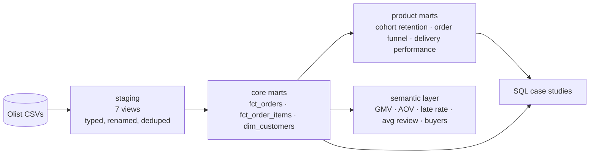

# Olist marketplace analytics: dbt + DuckDB

An end-to-end analytics project on **~100k real orders** from Olist, a Brazilian marketplace (2016–2018):
raw CSVs → tested dbt models → a governed semantic layer → SQL case studies that answer real product and ops questions.

Built to show how I work: model the data once, test it, define metrics in one place, then answer questions from those definitions.

## Headline findings
| | |
|---|---|
| 🚚 **Late delivery is the review score.** | Late orders average **2.27★ vs 4.29★**; 62% get 1–2★. The penalty starts 1 day late. |
| 🔁 **Retention is ~3%, and satisfaction doesn't move it.** | 1★ and 5★ first-time buyers return at almost the same rate (~3%); first-order **category** matters more (home/fashion ≈ 1.5–2×). |
| 📦 **The carrier leg is ~70% of the wait, and peaks break it.** | Late rate went from ~3% to **19%** in Mar 2018; the North/Northeast and Rio de Janeiro run 12–17% late. |
| 🏪 **GMV is concentrated.** | The top 1% of sellers drive 25% of GMV; the top 20% drive 82%. |

➡️ Full write-ups with the "so what": **[case_studies/README.md](case_studies/README.md)**

## What's inside


| Layer | Models | Notes |
|---|---|---|
| **Staging** (`models/staging/olist`) | 7 | Read in place by DuckDB, typed and renamed; reviews deduplicated on review + order |
| **Core** (`models/marts/core`) | `fct_orders`, `fct_order_items`, `dim_customers` | One order-level fact holds delivery timing vs promise, GMV and the customer's order sequence |
| **Product** (`models/marts/product`) | cohort retention, order funnel, delivery performance | Built on core marts only, never on raw data |
| **Semantic layer** (`models/marts/_semantic_layer.yml`) | 1 semantic model, 6 business metrics | GMV, AOV, late-delivery rate, average review score, orders, buyers, plus a time spine |
| **Tests** | **36 data tests** | unique / not_null / relationships / accepted values, a custom `unique_combination` test, and 2 singular tests (delivery can't come before purchase; payments reconcile to GMV) |

Latest `dbt build`: **49 pass, 1 warn, 0 errors**. The warning is deliberate: 1,021 orders (~1%) have payments that differ from items + freight by more than R$1, and they're reported rather than hidden.

## Run it yourself
```bash
# 1. Python 3.10–3.12
python -m venv .venv
.venv\Scripts\activate          # macOS/Linux: source .venv/bin/activate
pip install -r requirements.txt

# 2. Data: download from Kaggle and unzip into data/raw/olist/ (see data/raw/README.md)

# 3. Build models + run tests (writes olist.duckdb)
dbt build

# 4. Regenerate case-study results
python scripts/run_case_studies.py
```

## Design choices
- **DuckDB** keeps the project free and runnable on a laptop; the same models port to BigQuery, ClickHouse or Snowflake with minimal changes.
- **No packages:** the one generic test I'd normally take from `dbt_utils` is a 6-line macro, so `dbt deps` isn't needed.
- **Customer identity:** Olist issues a new `customer_id` per order, so every customer-level metric uses `customer_unique_id`. Getting this wrong inflates the customer count and hides repeat buyers.
- **"Late" is defined once** in `fct_orders` (delivered calendar day after the promised day) and reused everywhere, including the semantic layer.

## Data
[Brazilian E-Commerce Public Dataset by Olist](https://www.kaggle.com/datasets/olistbr/brazilian-ecommerce), CC BY-NC-SA 4.0. Not redistributed here.

---
**Himanshu Kumar** · Product & Business Analyst · [LinkedIn](https://www.linkedin.com/in/himanshuiitk2021/)
